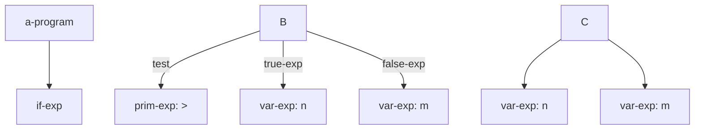
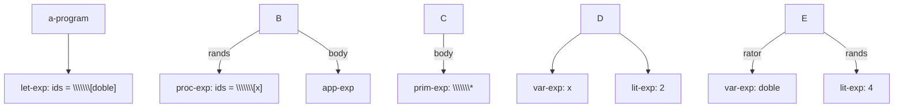
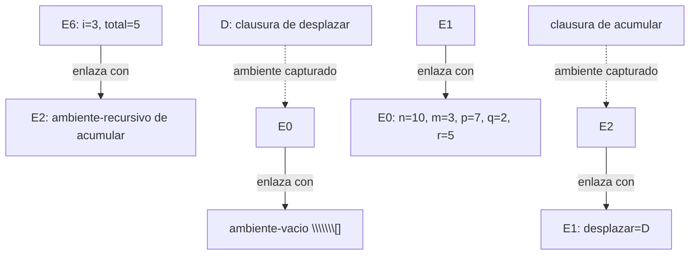

# Informe de AST — Taller 2: El intérprete de Cauca

**Curso:** Fundamentos de Interpretación y Compilación de Lenguajes de Programación — Universidad del Valle, Sede Tuluá.

**Integrantes del grupo:** completar con los datos reales antes de entregar.

|Nombre Andres Felipe Chaparro|Código 2266252|Chaparro.andres@correounivalle.edu.co|
|-|-|-|

\---

## 1\. Gramática considerada

La siguiente gramática resume las construcciones implementadas. Los nombres que aparecen a la derecha son los constructores que genera SLLGEN. `\\\\\\\*` representa cero o más repeticiones y `+` una o más repeticiones; los argumentos de primitivas y procedimientos se separan con comas.

```bnf
<programa> ::= <expresion>
               a-program(exp)

<expresion> ::= <numero>
                lit-exp(dato)
             | <identificador>
                var-exp(id)
             | "true"
                true-exp()
             | "false"
                false-exp()
             | <primitiva> "(" <lista-expresiones> ")"
                prim-exp(prim, rands)
             | "if" <expresion> "then" <expresion>
               "else" <expresion> "end"
                if-exp(test, true-exp, false-exp)
             | "let" (<identificador> "=" <expresion>)\\\\\\\*
               "in" <expresion> "end"
                let-exp(ids, rands, body)
             | "proc" "(" <lista-identificadores> ")"
               <expresion> "end"
                proc-exp(ids, body)
             | "apply" <expresion> "(" <lista-expresiones> ")"
                app-exp(rator, rands)
             | "letrec" (<identificador> "(" <lista-identificadores> ")"
               "=" <expresion>)\\\\\\\* "in" <expresion> "end"
                letrec-exp(proc-names, idss, bodies, body)
             | "case" <expresion> ("of" <numero> "=>" <expresion>)+
               "otherwise" "=>" <expresion> "end"
                case-exp(exp, valores, acciones, default)

<primitiva> ::= "+" | "-" | "\\\\\\\*" | "/" | "add1" | "sub1"
              | ">" | ">=" | "<" | "<=" | "=="
              | "not" | "and" | "or"
              | "abs" | "mcd" | "mcm" | "promedio"
              | "xor" | "implica" | "entre"
```

La gramática concreta del parser usa `arbno` en los lugares donde SLLGEN representa listas. `parser` agrega una validación posterior para exigir al menos una rama `of` en `case` y rechazar una aplicación que sea directamente el operador de otra aplicación, tal como pide el enunciado. Las producciones de `let` evalúan las expresiones de la derecha en el mismo ambiente anterior; no son ligaduras secuenciales.

\---

## 2\. Ejemplos de AST

### Ejemplo 1 — AST completo solicitado en el enunciado

**Expresión concreta:**

```cauca
let umbral = promedio(n, m, p)
in
  letrec
    contar (k) = if <=(k, umbral)
                 then apply contar (add1(k))
                 else k
                 end
  in
    case apply contar (1)
      of 7 => abs(-(umbral, 7))
      otherwise => mcd(n, m)
    end
  end
end
```

**AST:**

```mermaid
flowchart TD
  A\\\\\\\["a-program"] --> B\\\\\\\["let-exp: ids = \\\\\\\[umbral]"]
  B -->|rands| C\\\\\\\["prim-exp: promedio"]
  C --> C1\\\\\\\["var-exp: n"]
  C --> C2\\\\\\\["var-exp: m"]
  C --> C3\\\\\\\["var-exp: p"]
  B -->|body| D\\\\\\\["letrec-exp: proc-names = \\\\\\\[contar]"]
  D -->|idss: \\\\\\\[k]| D1\\\\\\\["parámetros de contar"]
  D -->|bodies| E\\\\\\\["if-exp"]
  E -->|test| F\\\\\\\["prim-exp: <="]
  F --> F1\\\\\\\["var-exp: k"]
  F --> F2\\\\\\\["var-exp: umbral"]
  E -->|true-exp| G\\\\\\\["app-exp"]
  G -->|rator| G1\\\\\\\["var-exp: contar"]
  G -->|rands| H\\\\\\\["prim-exp: add1"]
  H --> H1\\\\\\\["var-exp: k"]
  E -->|false-exp| I\\\\\\\["var-exp: k"]
  D -->|body| J\\\\\\\["case-exp: valores = \\\\\\\[7]"]
  J -->|control| K\\\\\\\["app-exp"]
  K -->|rator| K1\\\\\\\["var-exp: contar"]
  K -->|rands| K2\\\\\\\["lit-exp: 1"]
  J -->|acción de la rama 7| L\\\\\\\["prim-exp: abs"]
  L --> M\\\\\\\["prim-exp: -"]
  M --> M1\\\\\\\["var-exp: umbral"]
  M --> M2\\\\\\\["lit-exp: 7"]
  J -->|otherwise| N\\\\\\\["prim-exp: mcd"]
  N --> N1\\\\\\\["var-exp: n"]
  N --> N2\\\\\\\["var-exp: m"]
```

**Explicación:** `let-exp` liga el promedio a `umbral`. El `letrec-exp` declara `contar` y guarda su parámetro y su cuerpo sin evaluarlo. El cuerpo de `contar` es un `if-exp`; su rama verdadera contiene un `app-exp` recursivo. El `case-exp` evalúa la llamada a `contar` y selecciona la acción de la primera rama que coincide con el valor obtenido. Los números de las ramas de `case` se guardan directamente en el campo `valores`; por eso `7` no es un nodo `lit-exp` separado.

Con el ambiente inicial `n=10`, `m=3` y `p=7`, `promedio(n,m,p)=20/3`. `contar` alcanza `k=7`, pues `7 <= 20/3` es falso. La rama `of 7` devuelve `abs(20/3 - 7)=1/3`; `otherwise` no se evalúa.

\---

### Ejemplo 2 — Condicional con primitiva relacional

**Expresión concreta:**

```cauca
if >(n, m) then n else m end
```

**AST:**



**Explicación:** la condición es una `prim-exp` relacional con dos argumentos `var-exp`. Como `n=10` y `m=3`, la condición es verdadera y se evalúa solamente la rama `true-exp`; el resultado es `10`.

\---

### Ejemplo 3 — Procedimiento, clausura y aplicación

**Expresión concreta:**

```cauca
let doble = proc (x) \\\\\\\*(x, 2) end
in apply doble (4) end
```

**AST:**



**Explicación:** `proc-exp` construye una clausura que contiene el parámetro `x`, el cuerpo multiplicativo y el ambiente donde se definió. Después, `app-exp` busca esa clausura y la aplica al argumento `4`; el resultado es `8`.

\---

## 3\. Traza de evaluación

**Expresión a evaluar:**

```cauca
let desplazar = proc (x, d) +(x, d) end
in
  letrec
    acumular (i, total) = if >(i, m)
                          then total
                          else apply acumular
                                 (add1(i), apply desplazar (total, i))
                          end
  in
    apply acumular (1, q)
  end
end
```

**Ambiente inicial:**

(\\rho\_0 = \[n=10,\\ m=3,\\ p=7,\\ q=2,\\ r=5]).

### Notación de ambientes

* `E0 = \\\\\\\[n=10, m=3, p=7, q=2, r=5] -> \\\\\\\[]`, donde `\\\\\\\[]` es `ambiente-vacio`.
* `D = cerradura(\\\\\\\[x,d], +(x,d), E0)`: clausura de `desplazar`; captura el ambiente `E0`.
* `E1 = \\\\\\\[desplazar=D] -> E0`: ambiente creado por el `let`.
* `E2 = rec{acumular: (\\\\\\\[i,total], cuerpo)} -> E1`: ambiente recursivo; las clausuras de `acumular` capturan `E2`.
* `E3 = \\\\\\\[i=1,total=2] -> E2`, `E5 = \\\\\\\[i=2,total=3] -> E2`, `E6 = \\\\\\\[i=3,total=5] -> E2` y `E7 = \\\\\\\[i=4,total=8] -> E2`: ambientes de llamadas sucesivas a `acumular`.
* `E4 = \\\\\\\[x=2,d=1] -> E0`: ambiente del cuerpo de `desplazar` en su primera llamada. En llamadas posteriores se crean extensiones análogas directamente sobre `E0`.

### Pasos de la traza

|Paso|Expresión evaluada|Ambiente|Resultado|
|-:|-|-|-|
|1|Ambiente inicial|—|`E0 = \\\\\\\[n=10,m=3,p=7,q=2,r=5] -> \\\\\\\[]`|
|2|`proc (x,d) +(x,d) end`|`E0`|`D = cerradura(\\\\\\\[x,d], +(x,d), E0)`|
|3|Ligadura de `desplazar`|extensión de `E0`|`E1 = \\\\\\\[desplazar=D] -> E0`|
|4|Creación del ambiente de `letrec`|`E1`|`E2 = rec{acumular} -> E1`|
|5|Operador `acumular` de la llamada inicial|`E2`|Clausura recursiva que captura `E2`|
|6|Primer argumento `1`|`E2`|`1`|
|7|Segundo argumento `q`|`E2 -> E1 -> E0`|`2`|
|8|Cuerpo de `acumular`, con `i=1,total=2`|`E3 = \\\\\\\[i=1,total=2] -> E2`|Se evalúa el `if`|
|9|`>(i,m)`|`E3`; `m` se encuentra en `E0`|`1 > 3` = `#f`|
|10|`add1(i)`|`E3`|`2`|
|11|Operador `desplazar`|`E3 -> E2 -> E1`|Se obtiene `D`|
|12|Argumentos `total` e `i` de `desplazar`|`E3`|`(2,1)`|
|13|Cuerpo `+(x,d)` de `desplazar`|`\\\\\\\[x=2,d=1] -> E0`|`2+1=3`|
|14|Llamada recursiva `apply acumular (2,3)`|`E5 = \\\\\\\[i=2,total=3] -> E2`|Se inicia la siguiente activación|
|15|`>(i,m)`|`E5`; `m` se encuentra en `E0`|`2 > 3` = `#f`|
|16|`add1(i)`|`E5`|`3`|
|17|Argumentos `total` e `i` de `desplazar`|`E5`|`(3,2)`|
|18|Cuerpo `+(x,d)` de `desplazar`|`\\\\\\\[x=3,d=2] -> E0`|`3+2=5`|
|19|Segunda llamada recursiva `apply acumular (3,5)`|`E6 = \\\\\\\[i=3,total=5] -> E2`|Se inicia la activación con `i=3`|
|20|`>(i,m)`|`E6`; `m` se encuentra en `E0`|`3 > 3` = `#f`|
|21|`add1(i)`|`E6`|`4`|
|22|Argumentos `total` e `i` de `desplazar`|`E6`|`(5,3)`|
|23|Cuerpo `+(x,d)` de `desplazar`|`\\\\\\\[x=5,d=3] -> E0`|`5+3=8`|
|24|Llamada recursiva `apply acumular (4,8)`|`E7 = \\\\\\\[i=4,total=8] -> E2`|Se inicia la activación final|
|25|`>(i,m)`|`E7`; `m` se encuentra en `E0`|`4 > 3` = `#t`|
|26|Rama verdadera `total`|`E7`|`8`|
|27|Retorno de las llamadas pendientes|Ambientes de las llamadas anteriores|`8`|

El resultado del programa es **`8`**. En la segunda llamada recursiva, la activación con `i=3,total=5` usa `E6`, que apunta al ambiente recursivo `E2`. La clausura `desplazar`, en cambio, conserva `E0` y extiende ese ambiente con sus parámetros en cada llamada.

**Diagrama de la cadena de ambientes en la segunda llamada recursiva:**



Las flechas continuas representan los enlaces al ambiente anterior. Las flechas discontinuas muestran el ambiente que cada clausura guarda al definirse.

\---

## 4\. Estado del almacén en una transacción

**No aplica al lenguaje Cauca de este taller.** El lenguaje implementado no incluye un almacén mutable, referencias ni bloques transaccionales `atomic`; por ello no existe un estado del almacén que pueda ilustrarse antes, durante y después de una reversión.

\---

## 5\. Referencias

* Friedman, D. P., y Wand, M. *Essentials of Programming Languages*, 3.ª edición. MIT Press, 2008. Capítulo 3, sobre expresiones, intérpretes y ambientes.
* Repositorio base del taller, *FLP 2026-II — Taller 2: el intérprete de Cauca*: https://github.com/EjerciciosClasesCardel/flp-2026-2-taller-02-cauca.
* Documentación oficial de RackUnit: https://docs.racket-lang.org/rackunit/.

