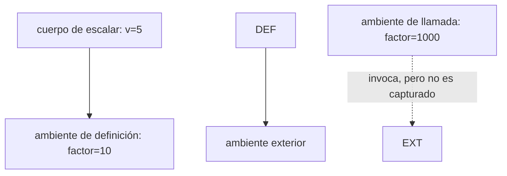
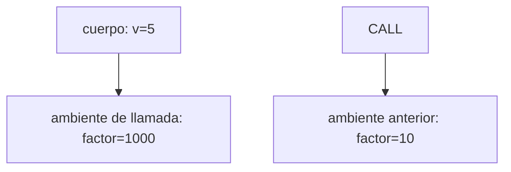

# Informe de corrección — Taller 2: El intérprete de Cauca

**Curso:** Fundamentos de Interpretación y Compilación de Lenguajes de Programación — Universidad del Valle, Sede Tuluá.

**Integrantes del grupo:** completar con los datos reales antes de entregar.

|Nombre|Código|Correo institucional|
|-|-|-|
|Andres Felipe Chaparro|2266252|chaparro.andres@correounivalle.edu.co|

\---

## 1\. Marco formal

### 1.1 Corrección de programas recursivos

Sea (f:A\\to B) una función especificada sobre un dominio recursivo y sea (P\_f) un programa que pretende calcularla. La corrección con respecto a la especificación significa que, para cada entrada válida (a\\in A), el programa termina y devuelve (f(a)):

$$
\\forall a\\in A,\\quad P\_f(a)=f(a).
$$

Una demostración por inducción estructural tiene un caso base para los valores mínimos del dominio y un caso inductivo que supone la propiedad para las subestructuras y la usa para demostrarla para la estructura compuesta. Cuando se analiza un intérprete, esta estrategia se aplica a estructuras como listas de ramas o expresiones recursivas; también se deben considerar explícitamente los casos de error especificados.

### 1.2 Corrección de programas iterativos

Para justificar la terminación de un proceso recursivo se identifica una medida (M) con valores en los naturales que disminuya estrictamente en cada llamada recursiva y esté acotada inferiormente. Si, además, cada paso mantiene una invariante que conecta el estado de ejecución con la especificación, se puede argumentar tanto la terminación como el resultado final.

En este taller el análisis se centra en `apply-procedure`, la representación recursiva de `letrec` y la selección de ramas de `case-exp`.

\---

## 2\. Funciones analizadas

### 2.1 Corrección de `apply-procedure`

#### Especificación

Sea una clausura (c=\\operatorname{cerradura}(\\vec{x},e,E\_d)), donde (\\vec{x}=\[x\_1,\\ldots,x\_n]) es la lista de parámetros, (e) es el cuerpo y (E\_d) es el ambiente de definición. Sea (\\vec{v}=\[v\_1,\\ldots,v\_m]) la lista de valores de los argumentos.

* **Tipo:** `apply-procedure : procval × lista-de-valores -> valor`.
* **Precondición de una aplicación válida:** el operador evaluado es una clausura de `procval` y (n=m). Cada argumento ya se ha evaluado en el ambiente de llamada.
* **Postcondición:** si se cumple la precondición y la evaluación del cuerpo termina, el resultado es (\\operatorname{eval}(e,E\_d\[\\vec{x}\\mapsto\\vec{v}])). Si (n\\ne m), `apply-procedure` levanta `eopl:error` antes de evaluar el cuerpo.

La expresión de aplicación también debe rechazar un operador cuyo valor no sea `procval`. Las expresiones usadas para calcular el operador o los argumentos pueden producir sus propios errores de evaluación; esos errores son distintos del error por aridad.

#### Código relevante

```racket
(define apply-procedure
  (lambda (proc args)
    (cases procval proc
      (cerradura (ids body env-def)
        (if (= (length ids) (length args))
            (evaluar-expresion body
              (ambiente-extendido ids args env-def))
            (eopl:error 'apply-procedure
              "Aridad incorrecta: se esperaban \\\~s argumentos y llegaron \\\~s"
              (length ids) (length args)))))))
```

#### Demostración del ambiente de evaluación

`proc-exp` construye la clausura con el ambiente vigente en el momento de su definición y mantiene el cuerpo sin evaluar. Cuando se aplica, `apply-procedure` obtiene `ids`, `body` y `env-def`; si la aridad coincide, crea `ambiente-extendido ids args env-def` y evalúa el cuerpo allí. El ambiente desde el que se invocó la clausura no se pasa a `apply-procedure`, de modo que no puede reemplazar al ambiente de definición.

Considérese el ejemplo exigido por el enunciado:

```cauca
let factor = 10
in
  let escalar = proc (v) \\\*(v, factor) end
  in
    let factor = 1000
    in apply escalar (5) end
  end
end
```

En la definición de `escalar`, el ambiente capturado liga `factor` a `10`. La llamada liga `v` a `5` sobre ese ambiente; el resultado es (5\\times10=50).

Cadena correcta de ambientes:



Si una implementación incorrecta usara el ambiente de llamada, la cadena sería la siguiente y la variable libre `factor` tomaría el valor `1000`:



El resultado de esa implementación incorrecta sería (5\\times1000=5000). La diferencia demuestra que utilizar el ambiente de llamada viola el alcance léxico: el significado de una clausura no debe cambiar según el lugar donde se invoque.

#### Casos de error

En `app-exp`, el intérprete evalúa el operador. Si su valor no satisface `procval?`, levanta `eopl:error` y no trata el valor como procedimiento. Si el operador sí es una clausura, evalúa los argumentos de izquierda a derecha y llama a `apply-procedure`. Esta función compara el número de argumentos y parámetros; si difieren, levanta `eopl:error` antes de evaluar el cuerpo. Por tanto, las dos condiciones de error de aplicación que especifica el enunciado —operador no procedimiento y aridad incompatible— se verifican en puntos explícitos. La evaluación del operador, los argumentos o el cuerpo puede fallar también por los errores propios de esas expresiones.

**Terminación.** `apply-procedure` no recurre sobre sus argumentos: después de la comprobación de aridad, delega en la evaluación del cuerpo. La terminación de una llamada completa depende de que esa evaluación termine; no se afirma que todos los programas recursivos de Cauca terminen.

**Conclusión:** `apply-procedure` respeta la especificación de aplicación cuando recibe una clausura y una lista de valores con la aridad correcta.

\---

### 2.2 Corrección de la ligadura recursiva mediante `letrec`

#### Especificación e invariante

Para una expresión `letrec` que declara los procedimientos (f\_1,\\ldots,f\_k), sea (E\_r) el ambiente recursivo creado para esas declaraciones. La invariante es:

> Toda clausura obtenida al resolver cualquiera de los nombres \\\\(f\\\_i\\\\) guarda el mismo ambiente recursivo \\\\(E\\\_r\\\\) como ambiente de definición. Por ello, al evaluar su cuerpo, puede resolver tanto su propio nombre como los nombres de los demás procedimientos declarados en el mismo `letrec`. Las variables libres que no pertenecen a ese grupo se buscan en el ambiente exterior capturado por \\\\(E\\\_r\\\\).

**Postcondición de la creación de `letrec`:** el cuerpo del `letrec` se evalúa en un `ambiente-recursivo` que contiene, en posiciones paralelas, los nombres, las listas de parámetros y los cuerpos sin evaluar de todas las declaraciones, junto con el ambiente exterior.

#### Código relevante de `apply-env`

```racket
(ambiente-recursivo (proc-names idss bodies anterior)
  (let ((proc (buscar-procedimiento id proc-names idss bodies env)))
    (if proc proc (apply-env anterior id))))
```

`buscar-procedimiento` construye `cerradura` con los parámetros y el cuerpo correspondientes, y usa `env` —el mismo ambiente recursivo sobre el que se hizo la búsqueda— como ambiente de definición.

#### Demostración de la invariante

Si el identificador buscado aparece en `proc-names`, `buscar-procedimiento` encuentra su posición y selecciona los parámetros y el cuerpo en esa misma posición de `idss` y `bodies`. La clausura resultante captura `env`, que es el `ambiente-recursivo` que contiene todas las declaraciones. Cuando se aplica la clausura, `apply-procedure` extiende ese ambiente con los argumentos. La búsqueda de un nombre recursivo vuelve a encontrarlo en el mismo `ambiente-recursivo`; una referencia a un nombre no recursivo continúa hacia `anterior`. Así se conserva la invariante tanto en recursión simple como mutua.

#### Por qué `let` no es suficiente

La siguiente declaración no define una función recursiva válida en este lenguaje:

```cauca
let factorial = proc (n)
  if ==(n, 0)
  then 1
  else \\\*(n, apply factorial (sub1(n)))
  end
end
in apply factorial (5) end
```

Las expresiones de la derecha de `let` se evalúan en el ambiente anterior a la creación de las nuevas ligaduras. Por ello, la clausura de `factorial` captura un ambiente donde aún no existe `factorial`. Al llegar a la llamada recursiva, `apply-env` busca el identificador y levanta el error **variable no ligada: factorial**. `letrec`, en cambio, introduce el ambiente recursivo que la clausura puede capturar.

#### Terminación del ejemplo `potencia`

Para el ejemplo del taller, `potencia(base, exp)` retorna `1` si `exp=0`; en otro caso multiplica `base` por `potencia(base, sub1(exp))`. Bajo la precondición (exp\\in\\mathbb{N}), la medida (M=exp) disminuye en una unidad en cada llamada y no puede disminuir indefinidamente en los naturales. La secuencia desde `10` llega a `0`, donde se alcanza el caso base. Por tanto, `apply potencia (2, 10)` termina y retorna (2^{10}=1024).

**Conclusión:** el ambiente recursivo permite que cada clausura de `letrec` encuentre el grupo completo de procedimientos, condición que no satisface una clausura creada con `let` ordinario.

\---

### 2.3 Corrección de `case-exp`

#### Especificación formal

Sea (e) la expresión de control, (E) el ambiente de evaluación y sea (B=\[(n\_1,e\_1),\\ldots,(n\_k,e\_k)]) la lista ordenada de ramas, seguida por la expresión predeterminada (e\_d). Primero se evalúa una sola vez (v=\\operatorname{eval}(e,E)).

* Si (v) no es numérico, la evaluación levanta `eopl:error`.
* Si (v) es numérico y existe un índice mínimo (j) con (v=n\_j), el resultado es (\\operatorname{eval}(e\_j,E)).
* Si no existe una rama coincidente, el resultado es (\\operatorname{eval}(e\_d,E)).

La gramática validada exige al menos una rama `of`.

#### Código relevante

```racket
(case-exp (control valores acciones default)
  (if (null? valores)
      (eopl:error 'evaluar-expresion
        "case requiere al menos una rama of")
      (let ((test-value (evaluar-expresion control env)))
        (if (number? test-value)
            (let ((respuesta
                    (buscar-rama test-value valores acciones env)))
              (if respuesta
                  (car respuesta)
                  (evaluar-expresion default env)))
            (eopl:error 'evaluar-expresion
              "La expresion de control de case debe ser numerica: \\\~s"
              test-value))))
```

#### Demostración por inducción estructural sobre la lista de ramas

**Caso base.** Si la lista de ramas está vacía, no hay coincidencias. `buscar-rama` devuelve el marcador de ausencia de resultado y el evaluador utiliza `otherwise`. La gramática validada impide que un programa de usuario llegue a ese caso con una lista vacía; la comprobación del evaluador funciona como defensa adicional.

**Paso inductivo.** Supóngase que el procedimiento aplicado a la cola de la lista devuelve la primera acción coincidente de esa cola o indica que no hay ninguna. Para una lista no vacía con primera rama ((n\_1,e\_1)):

1. Si (v=n\_1), `buscar-rama` evalúa y devuelve inmediatamente (e\_1). Ninguna rama posterior se inspecciona, de modo que se selecciona la primera coincidencia.
2. Si (v\\ne n\_1), continúa con la cola. Por hipótesis inductiva devuelve la primera coincidencia de la cola o el marcador de ausencia. Como la primera rama no coincidía, el resultado es también la primera coincidencia de la lista completa o `otherwise` si no queda ninguna.

Antes de recorrer la lista, `evaluar-expresion` comprueba `number?` sobre `test-value`. Por ello, si el control no es numérico, el intérprete levanta el error indicado en vez de comparar el valor con los literales de las ramas.

#### Evaluación única del control y terminación

`test-value` almacena el resultado de evaluar la expresión de control. `buscar-rama` recibe ese valor, no la expresión, de modo que el control se evalúa una sola vez sin importar el número de ramas. En cada llamada recursiva `buscar-rama` consume una rama y continúa con la cola; la longitud de la lista disminuye estrictamente hasta llegar al caso base. Por tanto, el recorrido de ramas termina.

**Conclusión:** `case-exp` selecciona la primera rama coincidente, recurre a `otherwise` cuando no hay coincidencias y rechaza un control no numérico.

\---

## 3\. Propiedades adicionales

### Prioridad de la ligadura más reciente (`apply-env`)

En `ambiente-extendido`, `apply-env` comprueba primero si el identificador aparece en la lista `ids` del ambiente actual. Solo si no aparece continúa con `anterior`. Por ello, si existe una ligadura local para `x`, esta tiene prioridad sobre cualquier ligadura de `x` en ambientes anteriores. Por ejemplo:

```cauca
let x = 1 in let x = 2 in x end end
```

retorna `2`, lo que ilustra el *shadowing*.

### Ligaduras simultáneas de `let`

`evaluar-expresion` evalúa primero la lista completa de expresiones de la derecha mediante `evaluar-rands` en el ambiente original y solo después crea `ambiente-extendido`. Por eso, las ligaduras del mismo `let` no están disponibles entre sí. El programa `let x = 1 y = x in y end` produce error si `x` no estaba ligado en el ambiente exterior. Esta propiedad coincide con la semántica simultánea pedida por el enunciado.

### Evaluación de argumentos de izquierda a derecha

`evaluar-rands` evalúa el primer argumento, lo coloca al inicio de la lista de resultados y luego recurre sobre el resto. Así mantiene el orden de evaluación definido en el taller para primitivas y aplicaciones de procedimientos.

\---

## 4\. Referencias

* Friedman, D. P., y Wand, M. *Essentials of Programming Languages*, 3.ª edición. MIT Press, 2008. Capítulo 3, sobre expresiones e intérpretes.
* Repositorio base del taller, *FLP 2026-II — Taller 2: el intérprete de Cauca*: https://github.com/EjerciciosClasesCardel/flp-2026-2-taller-02-cauca.
* Documentación oficial de RackUnit: https://docs.racket-lang.org/rackunit/.

